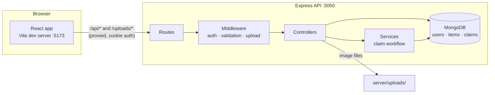

# FoundIt

> **Lost something? Let's bring it home.**

FoundIt is a lost-and-found web app for a college campus, built with the MERN stack (MongoDB, Express, React, Node.js) as an end-term software project.

---

## Problem statement

Students lose things on campus all the time: ID cards, water bottles, wallets, headphones, books, chargers. Today these items are usually traced through WhatsApp groups, announcements, or posts scattered across several places. Information gets buried, and the person who found an item has no reliable way to check that someone claiming it is the real owner.

## Target users

College students and staff who have lost or found a personal belonging on campus.

## Solution overview

FoundIt puts every lost and found report in one searchable place and handles the whole return process:

1. A student reports a **lost** item.
2. Someone else reports an item they **found**.
3. Anyone can **browse and search** the listings.
4. The likely owner **submits a claim** with identifying details only they would know.
5. The finder **reviews** the claim and **accepts** or **rejects** it.
6. When a claim is accepted, the two people can see each other's email address so they can arrange the handover.
7. Once the item is handed over, the finder **marks it as returned** and the listing becomes **resolved**.

The backend enforces every rule in this workflow (who can do what, and when). The frontend only shows the buttons that make sense; it does not decide permissions.

## Key features

- **Accounts**: register, log in, log out, and view your profile. Passwords are hashed with bcrypt, and the session is a JWT stored in an HTTP-only cookie.
- **Listings**: create, view, edit, close and delete lost/found listings, with an optional photo.
- **Search and filters**: text search on title and description, plus filters for type, category, location and status, sorting, and pagination. All of it runs as MongoDB queries.
- **Recovery claims**: submit a claim, review incoming claims, accept or reject them with an optional note, and mark an item as returned.
- **Dashboard**: your listings (with pending claim counts) and the claims you have submitted.
- **Feedback**: loading, empty and error states, inline form validation, toast notifications, and confirmation dialogs for actions that can't be undone.

## Tech stack

| Layer    | Tools |
|----------|-------|
| Frontend | React 19, Vite 7, Tailwind CSS 4, React Router 7, Axios, Lucide React |
| Backend  | Node.js, Express 5, Mongoose 8, jsonwebtoken, bcryptjs, cookie-parser, cors, Multer |
| Database | MongoDB (runs locally) |
| Dev tool | concurrently (starts client and server together) |

## Architecture



In development the Vite dev server proxies `/api` and `/uploads` to Express. The browser only talks to `localhost:5173`, so the login cookie works without extra cross-origin setup. CORS with credentials is still configured for `CLIENT_URL` in case you call the API directly.

## Main workflows and status rules

### Listing status (`Item.status`)

| From            | To              | Who / when |
|-----------------|-----------------|------------|
| *(new)*         | `open`          | Every new listing starts open. |
| `open`          | `claim_pending` | The finder accepts a claim on a **found** item. |
| `claim_pending` | `resolved`      | The finder marks the accepted claim as returned. |
| `open`          | `resolved`      | The owner of a **lost** item marks it "I got it back". |
| `open`          | `closed`        | The owner closes a listing that is no longer needed. Pending claims are rejected. |

- Only `open` listings can be edited, closed or receive claims.
- Listings with an accepted or completed claim cannot be deleted.
- Closed listings are hidden from the browse page.
- Clients can never set a status directly. Each change has its own endpoint, and the server checks the current state first.

### Claim status (`Claim.status`)

| From       | To          | Who / when |
|------------|-------------|------------|
| *(new)*    | `pending`   | A logged-in user (not the finder) claims an open found item. |
| `pending`  | `accepted`  | The finder accepts. **All other pending claims on that item are rejected automatically.** |
| `pending`  | `rejected`  | The finder rejects, another claim was accepted, or the listing was closed. |
| `accepted` | `completed` | The finder confirms the item was returned. The listing becomes `resolved`. |

Claims are only allowed on **found** items. People who see a **lost** listing are invited to post a found listing instead, which the owner can then claim.

### How conflicting accepts are prevented

The local MongoDB runs as a single server, not a replica set, so multi-document transactions aren't available. FoundIt uses **conditional atomic updates** instead. Accepting a claim first runs "set the item to `claim_pending` **only if it is still `open`**". If two accept requests arrive at the same moment, only one of them matches and the other receives `409 Conflict`. As a final safety net, a **unique partial index** on `claims` allows at most one `accepted`/`completed` claim per item. See `server/src/services/claimService.js`.

## Database models

**User**: `name`, `email` (unique, lower-cased), `passwordHash` (never returned by queries), timestamps.

**Item**: `title`, `description`, `type` (`lost` | `found`), `category`, `location`, `incidentDate`, `imageUrl` (nullable), `status`, `createdBy` → User, timestamps.
Indexes: `{status, type, category, createdAt}` and `{createdBy, createdAt}`.

**Claim**: `itemId` → Item, `claimantId` → User, `reporterId` → User (the finder, stored so permission checks need no extra lookup), `ownershipReason`, `identifyingDetails`, `additionalNotes`, `status`, `reviewNote`, `reviewedAt`, `completedAt`, timestamps.
Indexes:
- unique `{itemId, claimantId}` where status is `pending`/`accepted`, so a user has at most one active claim per item
- unique `{itemId}` where status is `accepted`/`completed`, so an item has at most one accepted claim

**Categories:** Electronics, ID Cards, Bags, Books and Stationery, Clothing, Accessories, Keys, Bottles, Other.

## API routes

All responses use `{ success: true, data, message? }` or `{ success: false, message, errors? }`, where `errors` maps field names to messages.

| Method | Route | Auth | Description |
|--------|-------|------|-------------|
| POST   | `/api/auth/register` | – | Create an account (logs you in) |
| POST   | `/api/auth/login` | – | Log in |
| POST   | `/api/auth/logout` | – | Clear the login cookie |
| GET    | `/api/auth/me` | ✔ | Current user's profile |
| GET    | `/api/items` | – | Browse. Query: `search`, `type`, `category`, `location`, `status` (`active`\|`open`\|`claim_pending`\|`resolved`\|`all`), `sort` (`newest`\|`oldest`\|`incident`), `page`, `limit` |
| GET    | `/api/items/mine` | ✔ | My listings with claim counts |
| GET    | `/api/items/:id` | optional | Listing details plus what the viewer may do (`viewer.canClaim`, `canEdit`, …) |
| POST   | `/api/items` | ✔ | Create a listing (multipart form, optional `image`) |
| PATCH  | `/api/items/:id` | owner | Edit an open listing (`removeImage=true` removes the photo) |
| DELETE | `/api/items/:id` | owner | Delete (not allowed after a claim is accepted) |
| PATCH  | `/api/items/:id/close` | owner | Close an open listing |
| PATCH  | `/api/items/:id/recovered` | owner | Mark a **lost** listing as recovered |
| POST   | `/api/items/:id/claims` | ✔ | Submit a claim on a found item |
| GET    | `/api/items/:id/claims` | finder | Incoming claims for my found item |
| GET    | `/api/claims/mine` | ✔ | Claims I have submitted |
| GET    | `/api/claims/:id` | claimant or finder | Claim details |
| PATCH  | `/api/claims/:id/decision` | finder | `{ decision: "accepted" \| "rejected", reviewNote? }` |
| PATCH  | `/api/claims/:id/complete` | finder | Mark the accepted claim as returned and resolve the listing |
| GET    | `/api/health` | – | Health check |

Claim details are never public. Contact emails are included only for `accepted` and `completed` claims, and only to the two people involved.

## Project structure

```
FoundIt/
├── client/                      React frontend (Vite)
│   ├── public/                  favicon
│   └── src/
│       ├── api/                 Axios instance + auth/items/claims API calls
│       ├── components/          Navbar, Footer, ItemCard, ClaimForm, ClaimActions, …
│       │   └── ui/              Button, Badges, FormField, ConfirmDialog, loading/empty/error states
│       ├── context/             AuthContext (current user), ToastContext (notifications)
│       ├── hooks/               useFetch, useDocumentTitle
│       ├── layouts/             MainLayout (navbar + footer) and Page container
│       ├── pages/               one file per page (Landing, Browse, ItemDetails, …)
│       ├── routes/              ProtectedRoute / GuestRoute
│       ├── utils/               constants, date formatting, form validation
│       ├── App.jsx              route table
│       └── main.jsx             entry point
├── server/                      Express API
│   ├── uploads/                 uploaded images (git-ignored)
│   └── src/
│       ├── config/              env loading, MongoDB connection
│       ├── controllers/         auth, item and claim request handlers
│       ├── middleware/          auth, validation, image upload, error handler
│       ├── models/              User, Item, Claim
│       ├── routes/              /api/auth, /api/items, /api/claims
│       ├── services/            claim workflow + browse query building
│       ├── validators/          request body validation rules
│       ├── scripts/seed.js      demo data
│       ├── utils/               constants, AppError, JWT/cookie helpers
│       ├── app.js               Express app setup
│       └── server.js            starts the server
├── .env.example
├── package.json                 workspace scripts (dev, server, client, db, seed)
└── README.md
```

## Local setup

### Requirements

- **Node.js 20+** (developed on Node 24) and npm
- **MongoDB Community Server 6+** installed locally ([download](https://www.mongodb.com/try/download/community)). On macOS with Homebrew: `brew tap mongodb/brew && brew install mongodb-community`.

### 1. Install dependencies

From the project root (npm workspaces install both `client` and `server`):

```bash
npm install
```

### 2. Start MongoDB

Choose one of these:

- **Option A, project-local database (easiest).** In its own terminal, run:

  ```bash
  npm run db
  ```

  This starts `mongod` on port 27017 with its data stored in `./.mongo-data`. Keep that terminal open.

- **Option B, a MongoDB service that is already running** (Homebrew service, Windows service, Docker, or Atlas). Point `MONGODB_URI` at it.

### 3. Create the environment file

```bash
cp .env.example .env
```

Then set `JWT_SECRET` to a long random string. You can generate one with:

```bash
node -e "console.log(require('crypto').randomBytes(48).toString('hex'))"
```

| Variable | Default | Purpose |
|----------|---------|---------|
| `PORT` | `5050` | Express API port. 5000 is avoided because macOS uses it for AirPlay. |
| `MONGODB_URI` | `mongodb://127.0.0.1:27017/foundit` | MongoDB connection string |
| `JWT_SECRET` | *(required)* | Secret used to sign login tokens |
| `JWT_EXPIRES_IN` | `7d` | How long a login lasts |
| `CLIENT_URL` | `http://localhost:5173` | Allowed CORS origin |
| `NODE_ENV` | `development` | `production` makes the cookie `Secure` and hides internal error messages |

Values in `.env` take priority over variables already set in your shell.

### 4. (Optional) Load demo data

```bash
npm run seed
```

> ⚠️ This **deletes all users, items and claims** in the database, then creates 3 demo users, 9 listings and 2 claims.
> Log in as `asha@college.edu`, `rahul@college.edu` or `meera@college.edu`. The password for all three is `password123`.

### 5. Run the app

```bash
npm run dev
```

This starts the API on **http://localhost:5050** and the React app on **http://localhost:5173**. Open **http://localhost:5173** in your browser.

| Script | What it does |
|--------|--------------|
| `npm run dev` | Starts the client and server together |
| `npm run server` | Starts only the API (auto-restarts on changes) |
| `npm run client` | Starts only the React dev server |
| `npm run db` | Starts a local `mongod` using `./.mongo-data` |
| `npm run seed` | Resets the database and loads demo data |
| `npm run build` | Builds the frontend for production into `client/dist` |

## Try the main workflow

With the demo data loaded:

1. Log in as **Rahul**. Go to **Browse items**, filter by **Found**, open **Grey hoodie**, and click **This is mine - claim it**. Fill in the details and submit.
2. Log out and log in as **Asha**, who found the hoodie. Open it from the **Dashboard**, click **Review claims**, then **Accept** and add a pickup note. Rahul's email is now visible to Asha, and Asha's to Rahul.
3. Click **Mark as returned** and confirm. The listing changes to **Resolved** and no longer accepts claims.
4. Also try: **Asha** has a pending claim from Rahul on *Blue steel water bottle*. **Meera** has an accepted claim on *Set of keys* that is waiting to be marked as returned.

## Image uploads

- Photos are optional. JPG, PNG and WEBP up to 2 MB are accepted.
- The server checks both the MIME type and the file's first bytes (its signature), so a renamed non-image file is rejected.
- Files are saved under `server/uploads/` with random UUID names and served at `/uploads/<name>`. MongoDB stores only the URL.
- Replacing or removing a photo, or deleting the listing, also deletes the old file.

## Known limitations

- **Local development only.** No deployment setup yet, and uploads are stored on the local disk.
- **No in-app messaging or notifications.** After a claim is accepted, the two people contact each other by email. Users see updates when they open the app.
- **No transactions.** Workflow safety relies on conditional updates and unique indexes (see above). With a MongoDB replica set this could be moved to transactions.
- **An accepted claim cannot be undone.** If a handover falls through, the listing stays in `claim_pending`. A "cancel acceptance" action would be a natural next step.
- **Search uses partial, case-insensitive matching** (regex) on title and description. That is fine for a campus-sized dataset, but a MongoDB text or Atlas Search index would scale better.
- **No password reset, email verification or admin moderation.** These were left out of scope on purpose.
- **No automated test suite.** The workflows were verified manually and with an API smoke script during development.
